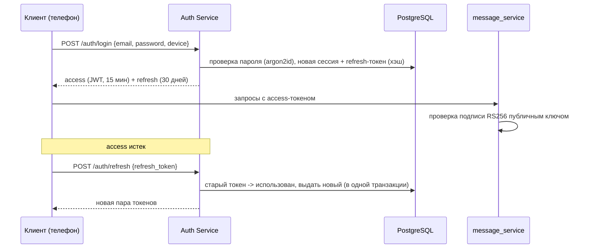

# Auth Service

Сервис регистрации и входа на Go. Выпускает JWT-токены для остальных сервисов
(например, [message_service](../message_service)) и ведет отдельную сессию на каждое устройство:
телефон, ноутбук, браузер — их видно в списке устройств и можно завершать по отдельности.

**Стек:** Go 1.26 · Echo · PostgreSQL (pgx, goose) · JWT RS256 · argon2id · Docker Compose · testcontainers

## Возможности

- **Регистрация и вход** по email и паролю; email и username уникальны без учета регистра.
- **Сессии устройств.** Каждый вход создает сессию со своим refresh-токеном. Устройство
  определяется по User-Agent («Chrome · Windows», «Safari · iPhone») или задается клиентом.
  Пользователь видит список устройств, может выйти на любом из них, на всех, кроме текущего,
  или только на текущем.
- **Ротация refresh-токенов с обнаружением кражи.** Каждый refresh-токен одноразовый.
  Повторное предъявление уже использованного токена означает, что его копия у кого-то еще:
  сессия завершается целиком.
- **Защита от перебора:** временная блокировка аккаунта после серии неудачных входов,
  лимит запросов к `/auth/*` с одного IP, одинаковое время ответа для существующих
  и несуществующих email.
- **Смена пароля** завершает все остальные сессии.
- **JWKS** (`/.well-known/jwks.json`) — другие сервисы берут публичный ключ по HTTP.

## Как это устроено



### Решения и компромиссы

| Решение | Почему |
|---|---|
| Короткий access (15 мин) + длинный refresh (30 дней) | Access проверяется другими сервисами без обращения к базе; refresh можно отозвать в любой момент. |
| Сессия на устройство | Потеряли телефон — завершаете только его, ноутбук продолжает работать. |
| Refresh-токен одноразовый | Украденный токен обнаруживается при первом же использовании любой из копий: вторая копия натыкается на «уже использован», сессия завершается. |
| Окно 10 секунд для повтора | Клиент мог не получить ответ на refresh из-за обрыва связи и повторить запрос. Это не кража: отвечаем `409 REFRESH_CONFLICT`, сессию не трогаем. |
| `SELECT ... FOR UPDATE` при обновлении | Два одновременных обновления одним токеном выполняются по очереди: выигрывает ровно один. Покрыто интеграционным тестом. |
| В базе только SHA-256 refresh-токенов | Утечка базы не дает рабочих токенов. Соль не нужна: в токене 256 бит случайности, перебор невозможен. |
| argon2id (m=19 МиБ, t=2, p=1) | Рекомендация OWASP. Параметры записаны в хэше, их можно усилить без миграции. |
| Скользящий срок сессии | Каждый refresh продлевает сессию: активные устройства не разлогинивает, брошенные истекают. |
| Лимит 10 сессий на пользователя | Бесконечный рост таблицы невозможен; при превышении завершается самая давно неиспользованная сессия. |
| `sid` в access-токене | Auth Service проверяет по нему, жива ли сессия: выход с устройства здесь действует мгновенно. |
| Блокировка аккаунта + лимит по IP | Блокировка (в БД, общая для всех экземпляров) защищает конкретный аккаунт, лимит по IP — от массового перебора. `X-Forwarded-For` учитывается только с `TRUST_PROXY=true`, иначе его можно подделать. |

**Известное ограничение.** Другие сервисы проверяют access-токен только по подписи, поэтому
после выхода с устройства его access-токен работает в них до истечения (не дольше 15 минут).
Варианты, если нужно мгновенно: публиковать событие «сессия завершена» в шину событий
(message_service закроет WebSocket и запомнит `sid` до истечения токена) или сократить TTL.

## Быстрый старт

```bash
cp .env.example .env          # задайте пароль PostgreSQL
go run ./cmd/keygen           # keys/jwt_private.pem и keys/jwt_public.pem
docker compose up -d --build  # PostgreSQL и сервис на http://localhost:8090
```

Миграции применяются при старте сервиса.

### Связка с message_service

message_service проверяет токены публичным ключом. Скопируйте его:

```bash
cp keys/jwt_public.pem ../message_service/keys/jwt_public.pem
```

Контракт токена: подпись RS256, `sub` — ID пользователя (ULID), `exp` обязателен,
`iss` = `auth-service`, `sid` — ID сессии, в заголовке `kid` — идентификатор ключа из JWKS.

### Пример

```bash
curl -s localhost:8090/api/v1/auth/register -H 'Content-Type: application/json' \
  -d '{"email":"alice@example.com","username":"alice","password":"s3cret-password","device":{"name":"MacBook","type":"laptop"}}'
```

```json
{
  "token_type": "Bearer",
  "access_token": "eyJhbGciOiJSUzI1NiIsImtpZCI6...",
  "expires_in": 900,
  "refresh_token": "rt_...",
  "refresh_expires_at": "...",
  "session": {"id": "...", "device_name": "MacBook", "device_type": "laptop", "current": true, "...": "..."},
  "user": {"id": "01J...", "email": "alice@example.com", "username": "alice"}
}
```

## API

| Метод | Путь | Авторизация | |
|---|---|---|---|
| `POST` | `/api/v1/auth/register` | — | регистрация, сразу открывает сессию |
| `POST` | `/api/v1/auth/login` | — | вход: `{email, password, device: {name, type}}` |
| `POST` | `/api/v1/auth/refresh` | — | `{refresh_token}` → новая пара токенов |
| `POST` | `/api/v1/auth/logout` | Bearer | выход на текущем устройстве |
| `GET` | `/api/v1/users/me` | Bearer | профиль |
| `PUT` | `/api/v1/users/me/password` | Bearer | смена пароля, остальные сессии завершаются |
| `GET` | `/api/v1/sessions` | Bearer | устройства, текущее помечено `current` |
| `DELETE` | `/api/v1/sessions/{id}` | Bearer | выход на конкретном устройстве |
| `DELETE` | `/api/v1/sessions` | Bearer | выход везде, кроме текущего |
| `GET` | `/.well-known/jwks.json` | — | публичные ключи |
| `GET` | `/healthz`, `/readyz` | — | пробы |

`device.type`: `phone`, `tablet`, `desktop`, `laptop`, `web`, `other`. Если не указан — определяется по User-Agent.

Ошибки приходят в формате `{"error": {"code": "...", "message": "..."}}`:

| Код | Статус | Когда |
|---|---|---|
| `VALIDATION_ERROR` / `INVALID_REQUEST` | 422 / 400 | неверный запрос |
| `EMAIL_TAKEN`, `USERNAME_TAKEN` | 409 | уже заняты |
| `INVALID_CREDENTIALS` | 401 | неверный email или пароль (не уточняется, что именно) |
| `ACCOUNT_LOCKED` | 429 + `Retry-After` | слишком много неудачных входов |
| `RATE_LIMITED` | 429 + `Retry-After` | слишком много запросов с IP |
| `UNAUTHORIZED` | 401 | нет токена, он недействителен или сессия завершена |
| `INVALID_REFRESH_TOKEN` | 401 | refresh-токен неизвестен, истек или сессия завершена |
| `REFRESH_TOKEN_REUSED` | 401 | признак кражи: сессия завершена, нужен повторный вход |
| `REFRESH_CONFLICT` | 409 | токен только что обменян другим запросом: используйте новый |

## Разработка

```bash
make test               # unit и e2e с -race
make test-integration   # против настоящего PostgreSQL (testcontainers, нужен Docker)
make lint
```

- **unit** — usecase поверх хранилища в памяти с настоящей семантикой транзакций:
  блокировка, сессии и лимит, ротация и кража refresh-токенов, смена пароля, устройства;
  пароли и токены (включая подмену алгоритма на HS256).
- **e2e** — HTTP API целиком: маршруты, middleware, коды ошибок, лимит по IP, JWKS.
- **integration** — PostgreSQL: миграции, уникальность без учета регистра, атомарный счетчик
  неудачных входов под конкурентной нагрузкой, гонка одновременных refresh одним токеном.

### Структура

```
cmd/app/                точка входа, graceful shutdown, фоновая чистка истекших токенов
cmd/keygen/             генерация пары RSA-ключей
internal/domain/        сущности и ошибки
internal/usecase/       бизнес-логика: регистрация, вход, сессии, ротация токенов
internal/security/      argon2id, JWT RS256, JWKS, refresh-токены
internal/storage/       PostgreSQL (+ миграции) и хранилище в памяти для тестов
internal/transport/http хендлеры, middleware, формат ошибок
internal/app/           сборка HTTP-сервера
```


